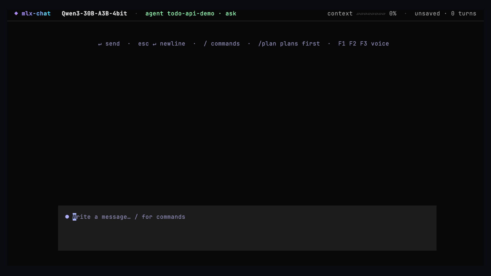

<div align="center">

# mlx-chat

**A local coding agent and chat for your terminal, running on Apple Silicon.**

[](CHANGELOG.md)
[](https://github.com/DevZoneX/infer-on-mac/actions/workflows/checks.yml)
[](https://www.python.org/)
[](#requirements)
[](https://github.com/ml-explore/mlx-lm)
[](LICENSE)



</div>

mlx-chat runs open models such as Qwen3 locally with [MLX-LM](https://github.com/ml-explore/mlx-lm).
It reads, searches, and edits the project you launch it in, runs commands, and asks
before anything changes. Nothing leaves your Mac.

## Features

- **Agent tools.** Lists, searches, outlines, and reads files. Edits files with a diff
  preview and runs shell commands. Every tool is confined to the workspace.
- **Approvals.** You choose what runs without asking: nothing (`ask`), file edits
  (`edits`), or everything (`all`).
- **Plan mode.** `/plan` explores read-only and proposes steps for you to run or revise.
- **Project memory.** Reads `AGENTS.md`, `CLAUDE.md`, or `.mlx-chat/instructions.md`.
- **Long sessions.** Older turns are compacted automatically, and a context meter shows usage.
- **Fast on a Mac.** Earlier messages stay byte-identical so the server's prompt cache
  reuses them, and the cache is sized to your unified memory.
- **Chat extras.** File attachments, prompt profiles, saved sessions, one-off scripted
  runs with JSON output, optional voice input and speech, and optional web search.

## Requirements

- Apple Silicon Mac, macOS 14 or newer
- Python 3.11+ ([uv](https://docs.astral.sh/uv/) recommended)
- Enough unified memory for the model you pick (see [Models](#models))

## Install

```sh
git clone https://github.com/DevZoneX/infer-on-mac.git
cd infer-on-mac
./setup.sh            # add --web and/or --voice for optional features
```

The installer creates `.venv` and links `mlx-chat` into `~/.local/bin`.
Other options are in the [installation reference](docs/REFERENCE.md#installation).

## Quick start

```sh
cd ~/code/my-app
mlx-chat medium
```

The first launch downloads the model from Hugging Face. Then describe the task:

```text
The empty-title test fails. Fix it and run the tests.
```

When the agent wants to change something, an approval card appears. Press Return to
allow it once, `a` to always allow that tool, or `n` to decline. You can also type
an instruction instead. Press Esc to stop a turn.

## Usage

| Command | What it does |
| --- | --- |
| `/plan TASK` | Explore read-only, then propose a plan to run or revise |
| `/approve ask\|edits\|all` | Set what runs without asking |
| `/memory`, `/memory add TEXT` | Show the project memory, or append a note to `AGENTS.md` |
| `/compact` | Summarize older turns to free context |
| `/tools` | List the tools and which ones need approval |
| `/agent off` | Switch to plain chat |
| `/attach PATH` | Add a file or folder to the next message |
| `/profile NAME` | Switch between `default`, `coding`, `writing`, or a saved profile |
| `/model NAME` | Switch models |
| `/save NAME`, `/load NAME` | Save or restore a session |
| `/help` | List every command |

From the shell:

```sh
mlx-chat run "Fix the failing test" --agent --approve edits   # non-interactive agent run
mlx-chat run "Summarize this file." --file notes.md --json     # one-off answer as JSON
mlx-chat doctor                                                # check the setup and suggest a model
mlx-chat serve | status | logs | stop                          # manage the local server
```

Use `--approve all` only in a folder you can restore, such as a clean git checkout.

## Models

| Shortcut | Model | Notes |
| --- | --- | --- |
| `tiny` (default) | `mlx-community/Qwen3-4B-4bit` | Fits any Apple Silicon Mac |
| `small` | `mlx-community/Qwen3-8B-4bit` | 16 GB+ |
| `medium` | `mlx-community/Qwen3-30B-A3B-4bit` | Best agent; about 3B active parameters per token, 32 GB+ |
| `large` | `mlx-community/Llama-3.3-70B-Instruct-4bit` | 64 GB+ |

Any MLX model ID from Hugging Face or a local model folder also works. Agent mode
needs a model whose chat template supports tool calls. Other models fall back to
plain chat. `mlx-chat doctor` recommends the largest shortcut that fits your memory.

## Privacy

Inference runs on a local server bound to `127.0.0.1`. The network is used only for
model downloads and for web tools you approve. Settings, sessions, and logs are stored
in `~/Library/Application Support/mlx-chat/`; set `MLX_CHAT_HOME` to change that.
See [SECURITY.md](SECURITY.md) for the trust model of the agent tools.

## Documentation

- [Command and configuration reference](docs/REFERENCE.md)
- [Troubleshooting](docs/REFERENCE.md#troubleshooting)
- [Changelog](CHANGELOG.md)
- [Contributing](CONTRIBUTING.md) · [Source layout](src/README.md) · [Tests](tests/README.md)

## License

[MIT](LICENSE). Model weights and dependencies keep their own licenses.
